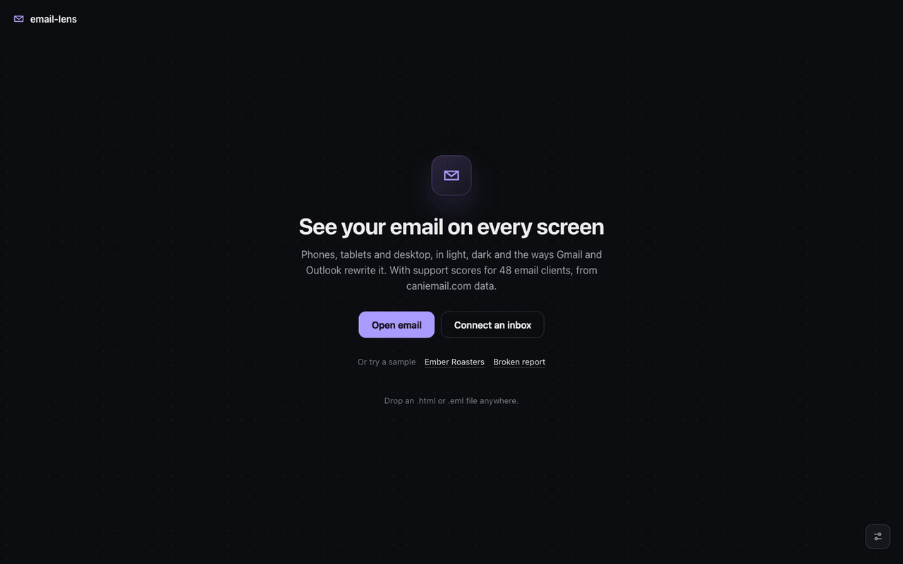

# email-lens

A free, local tool that checks whether an HTML email will survive real email clients and
devices. It runs on your machine, and no email content is uploaded anywhere.



▶ **[Watch the full tour](docs/media/tour.mp4)** (100 s, 2880×1800, 60 fps). Each section below
also has its own full-resolution clip.

- **Client support:** every HTML and CSS feature the email uses, checked against
  [caniemail.com](https://www.caniemail.com) data for ~48 clients (Gmail, Outlook, Apple Mail,
  Yahoo, Samsung Email, Thunderbird, AOL, ProtonMail and more), each scored, with the notes
  explaining *how* support is partial.
- **Device previews:** iPhone SE (320px) to desktop, in five modes: light, dark
  (`prefers-color-scheme`), forced dark (the colour inversion the Gmail and Outlook apps apply),
  no `<style>` (Gmail with non-Google accounts) and images off.
- **Real engines:** the email running in real WebKit (Apple Mail / iOS Mail), Chromium (webmail,
  Android) and Gecko (Thunderbird) pages, streamed into the device frames so you can scroll, hover
  and click (links are shown, not followed). Scripts are off, as in every email client.
- **Checks:** content overflowing phone screens (and which element causes it), Gmail's 102 KB
  clipping, low contrast in light and dark, text iOS will resize, small buttons, missing alt text,
  local/broken images and links, missing plain-text part, and more.

Email sources: paste HTML or a raw `.eml`, upload a file, or connect **Mailpit**, **MailHog** or
**Mailtrap**.

## Quick start

```bash
npm install
npm run browsers      # once: downloads WebKit, Chromium and Firefox for Real engines (optional)
npm start             # → http://localhost:4600
```

Without `npm run browsers` everything works except **Real engines**. The previews then
render in your own browser only.

### Nothing is stored

Real-engine screens are pages held open in memory on the local server; frames go straight to your
browser and are never written to disk. *Snapshot* opens a full-length image in a new tab without
saving it. A tile's engine page closes when you close the tile, switch modes or emails, leave the
page, stop the server, or after 60 seconds with nobody watching. Only the CLI's `--render <dir>`
writes files, to the folder you name.

## Walkthrough

Open http://localhost:4600 and paste an email, drop an `.html`/`.eml` file anywhere, or connect
an inbox. Two samples are built in: **Ember Roasters**, a polished autumn-launch email built the
robust way, and **Broken report**, which makes the classic mistakes.


### 1. Your email on every screen

The email sits on a stage in phone, tablet and laptop frames, all at their true viewport sizes
and scaled together so you can compare them. The chip at the top right is the average client
support score and the issue count. The dock at the bottom switches renderer, mode and devices.


Video: [stage and devices](docs/media/clip-1-stage.mp4)

### 2. Switch modes to see what clients do to it

*Dark* applies the email's own dark-mode CSS, as Apple Mail does. *Forced dark* simulates the
colour inversion of the Gmail and Outlook apps. *No `<style>`* removes embedded CSS, as Gmail does
for non-Google accounts. *Images off* blocks images, the default in many work inboxes. Keys
`1`–`5` switch modes.


| Dark (Ember's own dark styles) | Forced dark (Gmail / Outlook apps) |
|---|---|
|  |  |

Video: [modes](docs/media/clip-2-modes.mp4)

### 3. Inspect: score, clients, features

**Inspect** (or `I`) opens the inspector. *Overview* gives the verdict and the clients with the
least support. *Clients* scores all 48 clients from [caniemail.com](https://www.caniemail.com)
data; click one to see what it drops and why. *Features* lists every HTML/CSS feature the email
uses, where, and which clients fall short.


| Overview | Clients | Features |
|---|---|---|
|  |  |  |

Video: [inspector](docs/media/clip-3-inspector.mp4)

### 4. Fix the issues

Each screen gets an OK or error badge from layout checks run on the rendered email: overflow
(and the element causing it), shrink-to-fit, contrast, text size, tap targets. *Issues* collects
those plus checks on the HTML itself: Gmail's 102 KB clipping, viewport, alt text, links.


Video: [issues](docs/media/clip-4-issues.mp4)

### 5. Scroll and click it in real engines

**Real engines** swaps each screen for a real WebKit, Chromium or Firefox page running on your
machine, streamed in. Scroll, hover and click inside a screen; clicked links are shown instead of
followed. Nothing is saved to disk.


Video: [real engines](docs/media/clip-5-real-engines.mp4)

### 6. Open from anywhere

**Open email** takes pasted HTML or `.eml`, a file, or an inbox: browse Mailpit, MailHog or
Mailtrap to check what your app actually sends.


Video: [opening emails](docs/media/clip-6-open.mp4)

The slider button at the bottom right holds display tweaks: realistic or minimal frames, the
stage backdrop, and fit-to-screen or 100% size.

## Command line / CI

```bash
npx email-lens check public/samples/broken-report.html
npx email-lens check public/samples/ember-roasters.html
npx email-lens check email.html
npx email-lens check message.eml --clients "gmail.*,outlook.*,apple-mail.*" --min-score 80
npx email-lens check email.html --render ./shots     # also writes 30 engine screenshots
npx email-lens check email.html --json > report.json
npx email-lens update-data                            # refresh caniemail data
```

`check` exits with status 1 when it finds an error (overflow on a phone, Gmail clipping, broken
images, …) or a selected client scores below `--min-score`.

## Connecting a mail catcher

Under **Open email → Inbox**, pick *New Mailpit / MailHog / Mailtrap connection*, fill it in and connect.
Tick *Remember in this browser* to keep it in this browser's localStorage, password included.
To keep credentials out of the browser, define connections on the server instead, in
`~/.config/email-lens/sources.json` (or the file named by `EMAIL_LENS_SOURCES`):

```json
[
  { "name": "Local Mailpit", "type": "mailpit", "url": "http://localhost:8025" },
  { "name": "Staging Mailpit", "type": "mailpit", "url": "https://mail.staging.example.com", "username": "admin", "password": "…" },
  { "name": "Mailtrap sandbox", "type": "mailtrap", "token": "…", "accountId": "123456", "inboxId": "654321" }
]
```

| Type | Needs | Tested against |
|---|---|---|
| `mailpit` | `url` (the Mailpit web root), optional `username`/`password` for basic auth | Mailpit v1.22 |
| `mailhog` | `url`, optional basic auth | not yet; built to the MailHog v1/v2 API |
| `mailtrap` | API `token`, `accountId`, `inboxId` (Email Sandbox) | not yet; built to the Sandbox API |

## What it can and can't tell you

- The compatibility scores come from caniemail's tests of each feature in each client. A feature
  being unsupported is not always visible (an unsupported `box-shadow` just disappears), so read
  the scores together with the previews. Some entries are harmless by design: "HTML5 doctype
  unsupported" means the client drops the doctype.
- Previews and real engines use real browser engines, but they are not the clients themselves. Apple
  Mail and iOS Mail are WebKit with few changes, so those are close. Gmail and Outlook also
  rewrite your HTML; the *no `<style>`* and *forced dark* modes simulate the two rewrites that
  break the most emails.
- **Outlook for Windows** renders with Microsoft Word's engine, which can't be reproduced here.
  Its column in **Clients** and **Features** lists what it will drop; to see it, use a Windows
  machine or a paid service (Litmus, Email on Acid, Testi@) before a major release.

## Architecture

| Path | What |
|---|---|
| `src/compat.mjs` | Parses the HTML (htmlparser2) and every stylesheet and `style=""` (PostCSS, css-what), maps what it finds to caniemail feature slugs, and scores each client on the latest tested version |
| `src/lint.mjs` | Static checks (size, structure, accessibility) |
| `public/probe.js` | Layout checks on a rendered page; the same function runs in the UI's iframes and inside Playwright |
| `public/variants.js` | The preview modes (dark, forced dark, no style, images off) |
| `src/render.mjs` | Playwright engine pages and CLI screenshots |
| `src/live.mjs` | Live engine sessions: frame streaming (long-poll), input forwarding, idle cleanup |
| `src/sources.mjs` | Mailpit, MailHog, Mailtrap and `.eml` parsing |
| `src/server.mjs` | Local HTTP server (127.0.0.1 only) and JSON API |
| `data/caniemail.json` | Bundled caniemail dataset (MIT); refresh with `email-lens update-data` |

The existing npm checkers (`caniemail`, `doiuse-email`) throw on ordinary emails whenever a client
has no data for a feature, so email-lens has its own matcher and reports those as "untested".

## Tests

```bash
npm test
```

## Licence

MIT. Feature support data © caniemail.com contributors, MIT.
