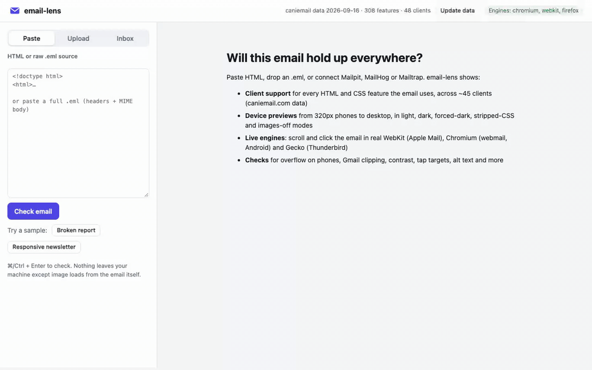
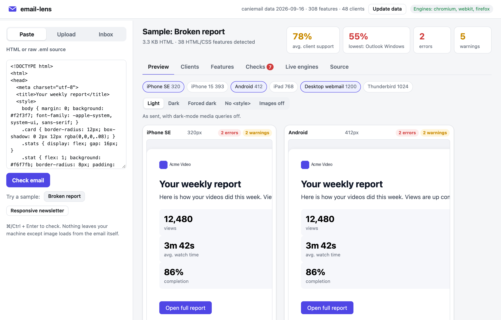
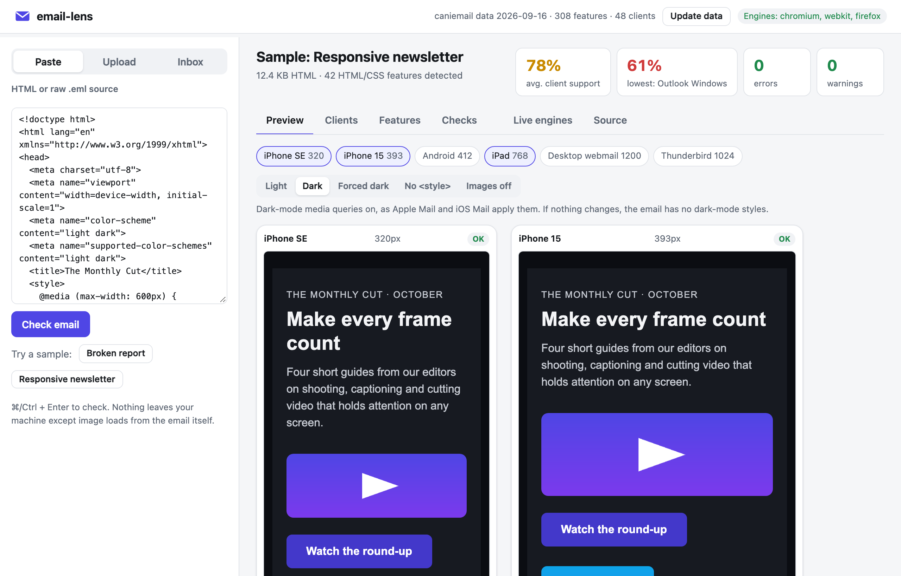
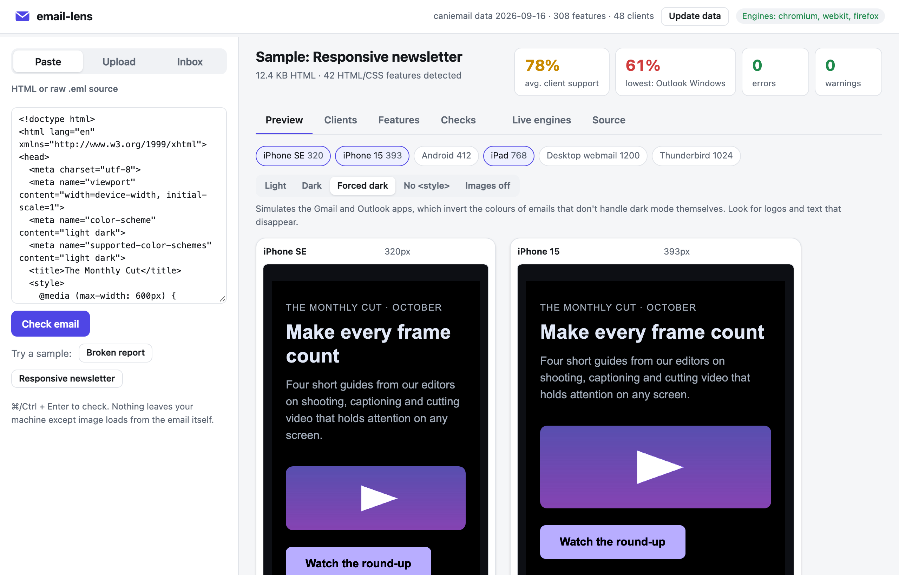
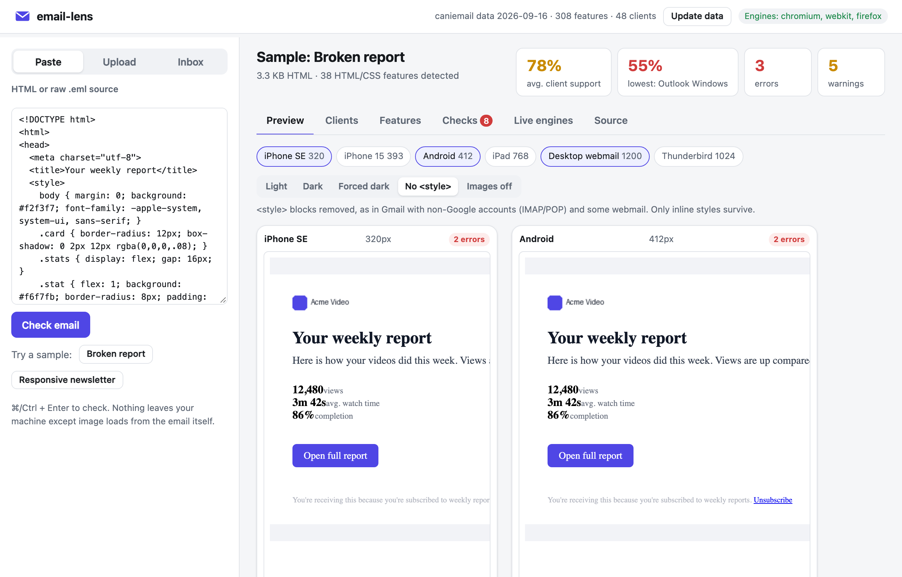
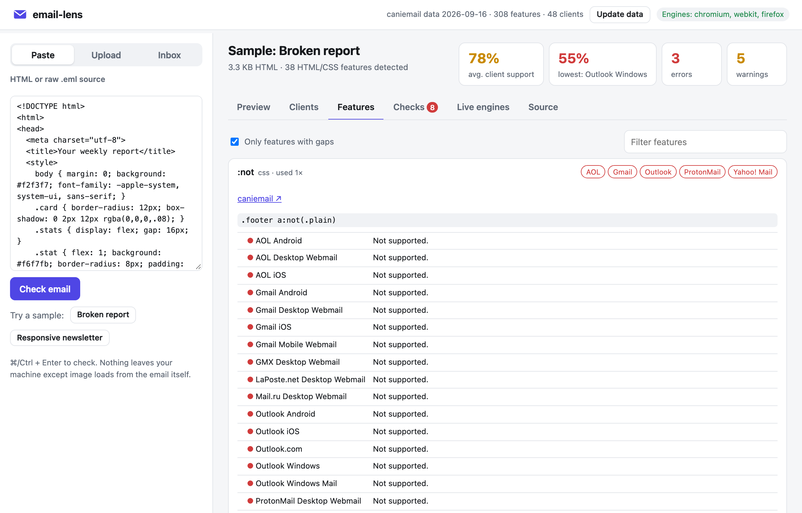
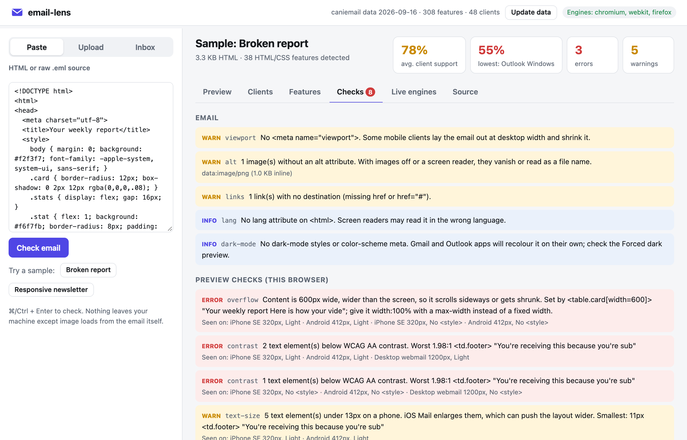
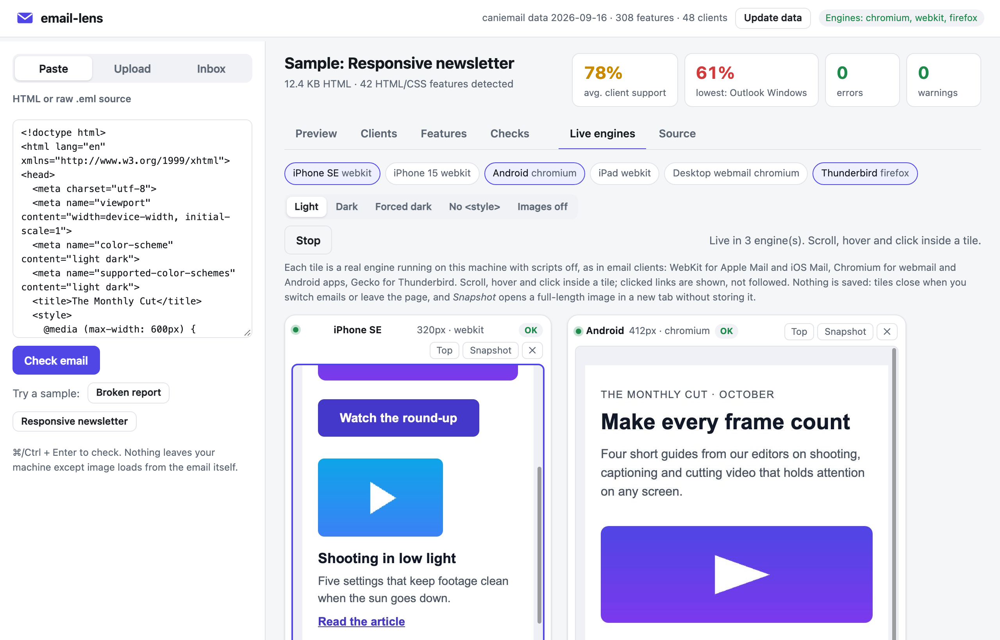
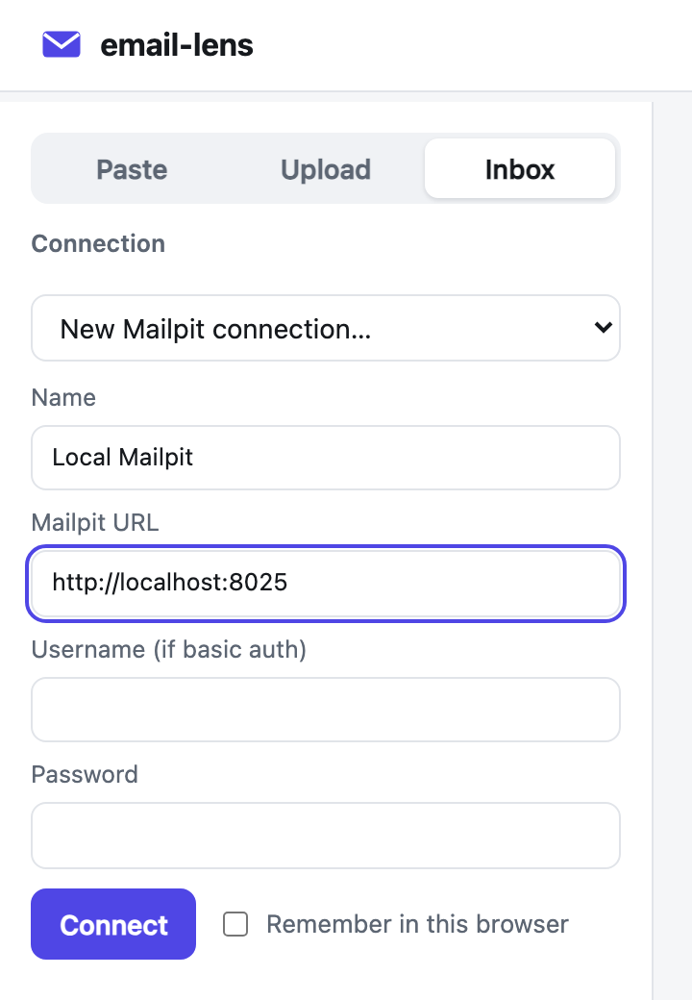

# email-lens

A free, local tool that checks whether an HTML email will survive real email clients and
devices. It runs on your machine, and no email content is uploaded anywhere.



- **Client support:** every HTML and CSS feature the email uses, checked against
  [caniemail.com](https://www.caniemail.com) data for ~48 clients (Gmail, Outlook, Apple Mail,
  Yahoo, Samsung Email, Thunderbird, AOL, ProtonMail and more), each scored, with the notes
  explaining *how* support is partial.
- **Device previews:** iPhone SE (320px) to desktop, in five modes: light, dark
  (`prefers-color-scheme`), forced dark (the colour inversion the Gmail and Outlook apps apply),
  no `<style>` (Gmail with non-Google accounts) and images off.
- **Live engines:** the email running in real WebKit (Apple Mail / iOS Mail), Chromium (webmail,
  Android) and Gecko (Thunderbird) pages, streamed into the app as tiles you can scroll, hover and
  click (links are shown, not followed). Scripts are off, as in every email client.
- **Checks:** content overflowing phone screens (and which element causes it), Gmail's 102 KB
  clipping, low contrast in light and dark, text iOS will resize, small buttons, missing alt text,
  local/broken images and links, missing plain-text part, and more.

Email sources: paste HTML or a raw `.eml`, upload a file, or connect **Mailpit**, **MailHog** or
**Mailtrap**.

## Quick start

```bash
npm install
npm run browsers      # once: downloads WebKit, Chromium and Firefox for Live engines (optional)
npm start             # → http://localhost:4600
```

Without `npm run browsers` everything works except the **Live engines** tab. The previews then
render in your own browser only.

### Nothing is stored

Live engine tiles are pages held open in memory on the local server; frames go straight to your
browser and are never written to disk. *Snapshot* opens a full-length image in a new tab without
saving it. A tile's engine page closes when you close the tile, switch modes or emails, leave the
page, stop the server, or after 60 seconds with nobody watching. Only the CLI's `--render <dir>`
writes files, to the folder you name.

## Walkthrough

Open http://localhost:4600 and paste an email, drop an `.html`/`.eml` file, or connect an inbox.
Two samples are built in: a **Broken report** with typical mistakes and a **Responsive
newsletter** that passes. The screenshots below use them.

### 1. Preview on every device

Each preview runs your email in an iframe at real device widths, with scripts off. Badges flag
problems found on that device. Here the broken sample's fixed 600px table overflows both phones.



### 2. Switch modes to see what clients do to it

*Dark* applies the email's own dark-mode CSS, as Apple Mail does. *Forced dark* simulates the
colour inversion of the Gmail and Outlook apps. *No `<style>`* removes embedded CSS, as Gmail does
for non-Google accounts. *Images off* blocks images, the default in many corporate clients.

| Dark (the newsletter's own dark styles) | Forced dark (Gmail / Outlook apps) |
|---|---|
|  |  |



### 3. See which clients support what

Every HTML and CSS feature in the email is matched against [caniemail.com](https://www.caniemail.com)
data. Each client gets a score; click one to see what it drops and why.


The **Features** tab turns it around: each feature, where it's used in your code, and which
clients don't support it, with caniemail's notes.



### 4. Read the checks

Problems found in the HTML itself (size, viewport, alt text, links) and in the rendered layout
(overflow and the element causing it, contrast, text size, tap targets), with the devices and
modes each one appeared on.



### 5. Scroll and click it in real engines

**Live engines** runs the email in real WebKit, Chromium and Firefox pages on your machine and
streams them into the app. Scroll, hover and click inside a tile; clicked links are shown
instead of followed. Nothing is saved to disk.



### 6. Or connect your mail catcher

Point it at Mailpit, MailHog or Mailtrap to browse and check what your app actually sends.



## Command line / CI

```bash
npx email-lens check public/samples/broken-report.html
npx email-lens check email.html
npx email-lens check message.eml --clients "gmail.*,outlook.*,apple-mail.*" --min-score 80
npx email-lens check email.html --render ./shots     # also writes 30 engine screenshots
npx email-lens check email.html --json > report.json
npx email-lens update-data                            # refresh caniemail data
```

`check` exits with status 1 when it finds an error (overflow on a phone, Gmail clipping, broken
images, …) or a selected client scores below `--min-score`.

## Connecting a mail catcher

In the **Inbox** tab, pick *New Mailpit / MailHog / Mailtrap connection*, fill it in and connect.
Tick *Remember in this browser* to keep it in this browser's localStorage, password included.
To keep credentials out of the browser, define connections on the server instead, in
`~/.config/email-lens/sources.json` (or the file named by `EMAIL_LENS_SOURCES`):

```json
[
  { "name": "Local Mailpit", "type": "mailpit", "url": "http://localhost:8025" },
  { "name": "Staging Mailpit", "type": "mailpit", "url": "https://mail.staging.example.com", "username": "admin", "password": "…" },
  { "name": "Mailtrap sandbox", "type": "mailtrap", "token": "…", "accountId": "123456", "inboxId": "654321" }
]
```

| Type | Needs | Tested against |
|---|---|---|
| `mailpit` | `url` (the Mailpit web root), optional `username`/`password` for basic auth | Mailpit v1.22 |
| `mailhog` | `url`, optional basic auth | not yet; built to the MailHog v1/v2 API |
| `mailtrap` | API `token`, `accountId`, `inboxId` (Email Sandbox) | not yet; built to the Sandbox API |

## What it can and can't tell you

- The compatibility scores come from caniemail's tests of each feature in each client. A feature
  being unsupported is not always visible (an unsupported `box-shadow` just disappears), so read
  the scores together with the previews. Some entries are harmless by design: "HTML5 doctype
  unsupported" means the client drops the doctype.
- Previews and live engines use real browser engines, but they are not the clients themselves. Apple
  Mail and iOS Mail are WebKit with few changes, so those are close. Gmail and Outlook also
  rewrite your HTML; the *no `<style>`* and *forced dark* modes simulate the two rewrites that
  break the most emails.
- **Outlook for Windows** renders with Microsoft Word's engine, which can't be reproduced here.
  Its column in **Clients** and **Features** lists what it will drop; to see it, use a Windows
  machine or a paid service (Litmus, Email on Acid, Testi@) before a major release.

## Architecture

| Path | What |
|---|---|
| `src/compat.mjs` | Parses the HTML (htmlparser2) and every stylesheet and `style=""` (PostCSS, css-what), maps what it finds to caniemail feature slugs, and scores each client on the latest tested version |
| `src/lint.mjs` | Static checks (size, structure, accessibility) |
| `public/probe.js` | Layout checks on a rendered page; the same function runs in the UI's iframes and inside Playwright |
| `public/variants.js` | The preview modes (dark, forced dark, no style, images off) |
| `src/render.mjs` | Playwright engine pages and CLI screenshots |
| `src/live.mjs` | Live engine sessions: frame streaming (long-poll), input forwarding, idle cleanup |
| `src/sources.mjs` | Mailpit, MailHog, Mailtrap and `.eml` parsing |
| `src/server.mjs` | Local HTTP server (127.0.0.1 only) and JSON API |
| `data/caniemail.json` | Bundled caniemail dataset (MIT); refresh with `email-lens update-data` |

The existing npm checkers (`caniemail`, `doiuse-email`) throw on ordinary emails whenever a client
has no data for a feature, so email-lens has its own matcher and reports those as "untested".

## Tests

```bash
npm test
```

## Licence

MIT. Feature support data © caniemail.com contributors, MIT.
